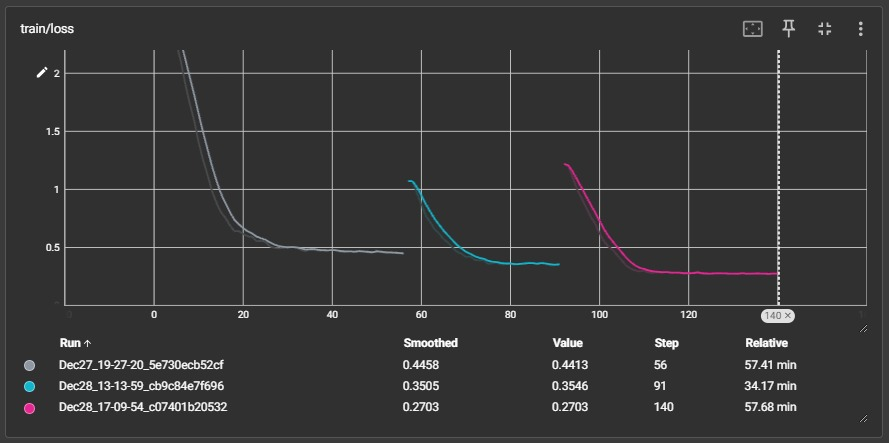
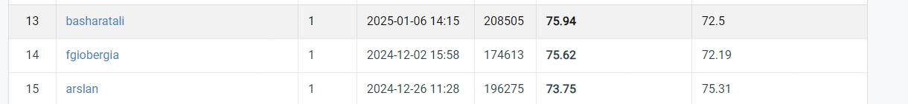
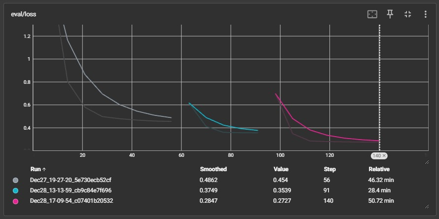

# TableTalk CodeGen: Fine-Tuning CodeLlama for Question Answering over Tabular Data

**CodeLlama-7B-Instruct** fine-tuned with **QLoRA** to answer natural-language questions about tables. Instead of answering directly, the model writes a **single line of pandas code**, which is then run against the table to produce the answer. Training and evaluation use the **DataBench** benchmark. The final entry on the Codabench leaderboard scored **75.94** on DataBench and **72.5** on DataBench Lite (rank 13, January 2025).

<p align="center">
  
</p>

## Problem and Motivation

Large language models handle free text well but are unreliable when an answer requires exact computation over structured data. Typical questions are "Is the person with the highest net worth self-made?" or "Which are the 4 neighbourhoods with the fewest listings?". If the model generates **executable code** instead of answering in prose, the calculation is done by pandas, so the answer can be checked and the model doesn't need to read the whole table.

The project asks how well an open 7B code model, fine-tuned cheaply on a single GPU, can turn a question plus schema information (column names and types) into a correct one-line pandas expression.

## Dataset

**DataBench** (Grijalba et al., LREC-COLING 2024; on Hugging Face as [`cardiffnlp/databench`](https://huggingface.co/datasets/cardiffnlp/databench)) has 65 real-world tables with 20 hand-written questions each (1,300 QA pairs). According to the report it spans about 3.27 M rows and 1,615 columns:

| Domain | Datasets | Rows | Columns |
|---|---|---|---|
| Business | 26 | 1,156,538 | 534 |
| Health | 7 | 98,032 | 123 |
| Social | 16 | 1,189,476 | 508 |
| Sports | 6 | 398,778 | 177 |
| Travel | 10 | 427,151 | 273 |
| **Total** | **65** | **3,269,975** | **1,615** |

Each question specifies the expected answer type (for example boolean, number, category or list). Column names carry type suffixes such as `author_name<gx:category>`. The notebook's data folder (`SemEval2025Task8Data`) and the Codabench submissions indicate the work was done for **SemEval-2025 Task 8** (question answering over tabular data).

**Data used in the notebook** (not included in this repository):
- `final2.csv`: 988 training questions, each with the columns used, column types, answer type and a hand-prepared ground-truth pandas one-liner (`Code Line`). Before training, unclear questions were refined, inconsistent `columns_used` entries were fixed and an exact code line was written for every question (report §IV-A). The notebook splits these 90/10 into 889 training and 99 validation examples.
- `test.csv`: 320 evaluation questions with gold answers.
- `data/<dataset>/all.parquet`: the DataBench tables the generated code runs against.

## Approach

1. **Prompt construction.** Each example becomes an instruction prompt containing the question, the relevant columns, their dtypes and the expected answer type. The prompt asks for exactly one line of Python on a pre-loaded DataFrame `df`, using the exact column names. The completion is the ground-truth code line.
2. **QLoRA fine-tuning.** The base model `meta-llama/CodeLlama-7b-Instruct-hf` is loaded in **4-bit NF4** with double quantisation and bfloat16 compute. **LoRA** adapters (r = 16, α = 64, dropout 0.1) are added to `q_proj`, `k_proj`, `v_proj` and `o_proj`, and trained with TRL's `SFTTrainer`.

   | Hyperparameter | Value |
   |---|---|
   | Batch size × gradient accumulation | 16 × 8 (effective batch 128) |
   | Optimiser | Paged AdamW 32-bit |
   | Learning rate | 1e-4, linear decay |
   | Epochs | 20 (early stopping, patience 3) |
   | Hardware | Google Colab, 1 × NVIDIA T4 |

3. **Inference.** The fine-tuned model generates one code line per evaluation question with a Hugging Face `text-generation` pipeline, in batches of 32.
4. **Execution and scoring.** Each generated line is cleaned (backticks, code fences and special tokens removed) and evaluated with `eval` against its DataBench table. Errors are recorded instead of stopping the run. Answers are compared with the gold answers locally, and the answer files were submitted to Codabench for official scoring.

The report also fine-tunes **CodeLlama-Python-7B** (batch size 8, 14 epochs) for comparison. That training code isn't part of this repository.

## Results

**Training** (CodeLlama-7B-Instruct, per-epoch values from the notebook output; training ran over three resumed Colab sessions)

| Epoch | Training loss | Validation loss |
|---|---|---|
| 8 | 0.4413 | 0.4540 |
| 13 | 0.3546 | 0.3539 |
| 20 | **0.2703** | **0.2727** |

**Evaluation** (320 questions)

| Model | Metric | Score | Source |
|---|---|---|---|
| CodeLlama-7B-Instruct | Local exact-match accuracy | 66.25 % | Notebook output (Accuracy section) |
| CodeLlama-7B-Instruct | **Codabench leaderboard, final entry (submission 208505, 6 Jan 2025, rank 13): DataBench** | **75.94** | `assets/codabench_leaderboard.jpeg` |
| CodeLlama-7B-Instruct | Codabench leaderboard, final entry: DataBench Lite | 72.5 | Same screenshot |
| CodeLlama-7B-Instruct | Codabench DataBench score (earlier submission `Results_8`, 30 Dec 2024) | 72.50 | `results/codellama_7b_instruct/scoring_result_CodeBench.zip` (`scores.json`) |
| CodeLlama-7B-Instruct | Codabench DataBench Lite score (earlier submission `Results_8`) | 17.81 | Same `scores.json` |
| CodeLlama-Python-7B | Codabench DataBench score (submission `Results_9`, 31 Dec 2024) | 70.63 | Report, Table V |

- **DataBench Lite** asks the same questions over smaller subsets of each table, so models are scored on both the full tables and the reduced versions.
- In the recorded run, 23 of the 320 generated code lines raised an error when executed. Causes included wrong column names, syntax errors and operations that don't fit a column's dtype.
- The local exact-match metric is stricter than the official type-aware DataBench scorer, which likely explains the gap between 66.25 % and the Codabench scores.
- The report gives training and validation losses of 0.27 for CodeLlama-7B-Instruct and 0.15 for CodeLlama-Python-7B. The Python variant reached a lower loss, but the Instruct model scored slightly higher on the benchmark (72.50 vs 70.63 in the December 2024 submissions).
- The December 2024 submission history (scores from 61.88 to 72.50) is shown in `docs/latex/Codebench.jpg`. The final leaderboard entry (75.94, 6 January 2025) came after the submissions in that screenshot and is shown below.

<p align="center">
  
</p>

| Training loss | Validation loss |
|---|---|
|  |  |

Learning-rate, gradient-norm, epoch and evaluation-runtime charts are also in `assets/`.

### Findings
- QLoRA makes it possible to fine-tune a 7B code model on a single 16 GB T4 GPU, at about 2.6 hours of training time across the three sessions (sum of the recorded `train_runtime` values).
- The instruction-tuned base model translated questions into executable pandas slightly better than the Python-specialised one, even though its training loss was higher.
- Execution failures came mostly from column-name handling and dtype-specific pandas calls. The report suggests closer integration with database systems and richer data handling as future work.

## Tech Stack

- **Language:** Python 3.10 (Google Colab)
- **Models:** Meta CodeLlama-7B-Instruct (Hugging Face)
- **Fine-tuning:** Transformers, PEFT (LoRA), TRL (`SFTTrainer`), bitsandbytes (4-bit NF4), Accelerate
- **Data:** pandas, NumPy, Hugging Face Datasets, fastparquet
- **Monitoring:** TensorBoard

## Setup and Usage

```bash
git clone https://github.com/BasharatWali/TableTalk_CodeGen.git
cd TableTalk_CodeGen
pip install -r requirements.txt
jupyter notebook notebooks/CodeLlama_Instruct_Finetuned.ipynb
```

Requirements and notes:
- **GPU:** a CUDA GPU with at least 16 GB of memory is needed (the original run used a Colab T4).
- **Model access:** CodeLlama is a gated model. Accept Meta's licence on its Hugging Face page and log in with your own token. The notebook calls `notebook_login()`.
- **Data:** download DataBench from Hugging Face and prepare the training CSV (`final2.csv`), evaluation CSV (`test.csv`) and the per-dataset Parquet files, then update the hard-coded Google Drive paths (`/content/drive/MyDrive/SemEval2025Task8Data/...`).
- **Library versions:** the notebook installed `transformers`, `peft` and `accelerate` from their GitHub main branches in December 2024, so no versions were recorded. TRL's `SFTTrainer` API has changed since then, and argument names may need adjusting for newer releases.
- **Safety:** the evaluation step runs model-generated code with `eval`. Only run it in an isolated environment.

## Project Structure

```
TableTalk_CodeGen/
├── notebooks/
│   └── CodeLlama_Instruct_Finetuned.ipynb   # Data prep, QLoRA fine-tuning, inference, execution, scoring
├── docs/
│   ├── Final_Report.pdf                     # Project report (IEEE format)
│   └── latex/                               # LaTeX source of the report and its figures
├── assets/                                  # TensorBoard charts and the Codabench leaderboard screenshot
├── results/
│   └── codellama_7b_instruct/
│       ├── predictions.txt                  # One answer per question (DataBench)
│       ├── predictions_lite.txt             # One answer per question (DataBench Lite)
│       ├── Results_8.zip                    # Codabench submission (same two files)
│       ├── prediction_result_CodeBench.zip  # Copy of the submission as returned by Codabench
│       └── scoring_result_CodeBench.zip     # Codabench scores (scores.json)
├── requirements.txt
├── .gitignore
└── README.md
```

## Notes

- **Python-7B code missing:** the CodeLlama-Python-7B comparison model is described in the report only. Its training notebook isn't included.
- **Inference checkpoint:** as written, the inference section loads `checkpoint-91` (end of epoch 13) rather than the final epoch-20 adapter.
- **Prompt format:** inference uses the Llama-2 chat template (`<s>[INST] … [/INST]`) and slightly different instruction wording from the `### Answer:` format used in training.
- **Resumed sessions:** the training curves show that each resumed session restarted from a higher loss and a fresh learning-rate schedule. Training was therefore not one continuous 20-epoch run.

## Author

**Basharat Ali**, National University of Sciences and Technology (NUST), Islamabad, Pakistan.

## Reference

J. O. Grijalba, L. A. U. Lopez, E. Martínez-Cámara and J. Camacho-Collados, "Question Answering over Tabular Data with DataBench: A Large-Scale Empirical Evaluation of LLMs," in *Proceedings of LREC-COLING 2024*, pp. 13471–13488.
